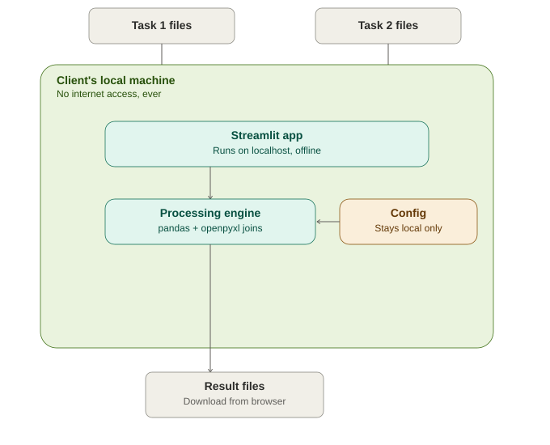
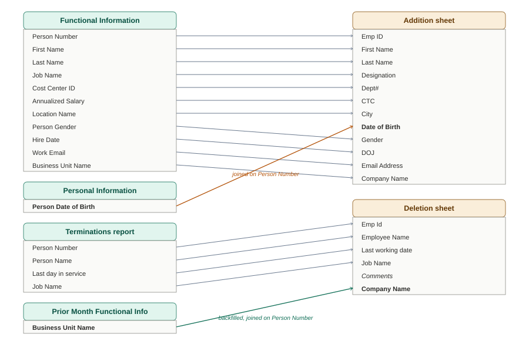
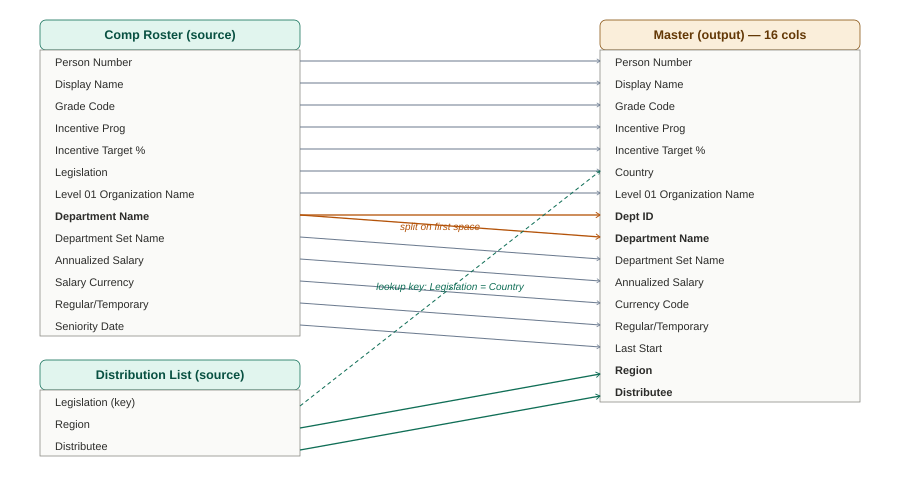

# Report Automation (offline, config-driven)

A local desktop tool that turns a set of raw HR system exports into two
standardized reporting deliverables — with zero internet access and zero
cost to run.

> **All data, names, and organization structure in this repo are synthetic.**
> This is a genericized version of a real consulting engagement; the real
> client's config, column mappings, and data never leave their machine.



## What it does

**Task 1 — Addition & Deletion File**
Joins a hiring export, a personal-info export (DOB only), and a
terminations export into a single workbook with two tabs, renaming and
remapping columns along the way, plus a QA flag for company-name mismatches.



**Task 2 — Monthly Accrual File**
Takes a compensation roster and a distribution list and produces:
- a **Master** sheet with derived columns (an ID parsed out of a combined
  department field, plus a region/owner lookup)
- an **HC** headcount pivot
- the same data re-filtered into **7 separate regional workbooks**, each
  with its own HC tab — including one region that's further split into
  3 sub-category tabs (each with its own HC tab too)



## Why it's built this way

The client's real business logic — actual region names, actual department
codes, actual reporting-line owners — is confidential and can never touch
version control or the internet. So the project is split in two:

- **Engine** (this repo): generic transformation logic. Knows *how* to
  rename columns, split an ID out of a text field, do a lookup join, and
  build a pivot — knows nothing about any specific company.
- **Config** (`sample_config.json` here, the client's real file in
  production): the actual field mappings, the actual regional split rules.
  This is the only place anything client-specific lives, and in production
  it never leaves the client's machine.

Change the config, get a different client's report, with no code changes.

## Running it

```bash
pip install -r requirements.txt
python generate_sample_data.py     # creates fictional sample files in sample_data/
streamlit run app.py               # opens at http://localhost:8501
```

Upload the generated sample files through the UI, hit Process, download
the result. Nothing here calls out to the internet — `.streamlit/config.toml`
disables Streamlit's own anonymous usage telemetry so no request leaves
the machine even in the background.

## Building the standalone offline .exe

For a non-technical end user, package it once with PyInstaller so they
never need to install Python or anything else:

```bash
pip install pyinstaller
pyinstaller build_exe.spec
```

The result is a folder (`dist/Report_Automation/`) with a single
executable the client double-clicks — it opens the browser to the local
app automatically. No install step, no internet connection, ever.

## Project structure

```
app.py                     Streamlit UI
engine/
  config_loader.py         reads/validates the JSON config
  addition_deletion.py     Task 1 transform logic
  monthly_accrual.py       Task 2 transform logic (id split, lookup, pivot, regional split)
sample_config.json         fictional mapping/config used by this demo
sample_data/                fictional source files (generated, not committed pre-made)
generate_sample_data.py    creates the fictional sample files
run_app.py                 entry point used only for the PyInstaller build
build_exe.spec             PyInstaller build spec
docs/architecture.svg      the diagram above
```

## Tech stack

Python · pandas · openpyxl · Streamlit · PyInstaller
